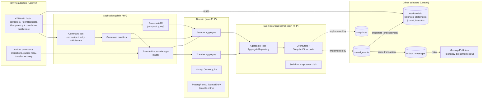
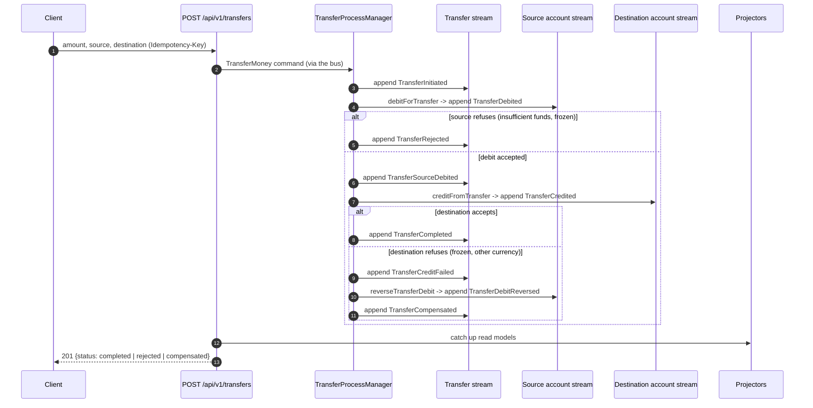

# event-sourced-ledger

A double-entry, multi-currency wallet ledger built with **Event Sourcing**, **CQRS** and a
**hexagonal (ports and adapters)** architecture on Laravel 12.

The event store, snapshots, upcasting, projections, the transfer saga and the transactional
outbox are written from scratch, in small framework-free classes, because showing how they
work is the point of the project. Everything is covered by tests that run against SQLite,
MySQL and PostgreSQL.

- [What it does](#what-it-does)
- [Architecture](#architecture)
- [How the mechanics work](#how-the-mechanics-work)
- [Running it](#running-it)
- [API by example](#api-by-example)
- [Testing and quality](#testing-and-quality)
- [Design decisions](#design-decisions)
- [Known limitations](#known-limitations)

## What it does

- Open accounts in any of 31 ISO 4217 currencies, with an optional overdraft limit.
- Deposit, withdraw, freeze and unfreeze accounts.
- Transfer between accounts: debit, credit, and an automatic refund (compensation) if the
  destination refuses the money.
- Keep a general journal in which every movement is a balanced double entry, and expose a
  trial balance.
- Answer "what was the balance at 14:03 last Tuesday?" by replaying events up to that moment.
- Publish integration events to other systems without ever losing or inventing one.
- Accept retries safely: every `POST` honours an `Idempotency-Key` header.

## Architecture



Dependencies only point inwards. `tests/Architecture` parses every source file with PHP's
tokenizer and fails the build if:

- `src/EventSourcing` imports anything outside itself,
- `src/Domain` imports anything but the domain and the kernel (no `Illuminate\*`),
- `src/Application` imports a framework class or an adapter,
- anything in `src/` depends on Laravel's `App\` namespace.

```
src/
  EventSourcing/   framework-free kernel: aggregates, event store port, snapshots, upcasting
  Domain/          Account, Transfer, Money, double-entry posting rules
  Application/     commands, handlers, command bus, transfer saga, temporal query, ports
  Infrastructure/  database event store, projectors, read models, outbox, upcasters
app/               Laravel: HTTP controllers, requests, middleware, artisan commands, wiring
docs/              openapi.yaml and architecture decision records
```

### A transfer, step by step



Each arrow into a stream is a separate, atomic append with optimistic concurrency and its
own retry. Every account step is idempotent per transfer id, so the saga can be resumed
from any point after a crash (`php artisan ledger:transfers:resume`) without moving money
twice.

## How the mechanics work

### Event store

One append-only table, `stored_events`:

| column | purpose |
|---|---|
| `position` | global auto-increment sequence; projections read in this order |
| `stream_id`, `version` | e.g. `account-<uuid>`, 1, 2, 3 ... **unique together** |
| `event_type`, `schema_version` | stable name (`account.money_deposited`) and payload version |
| `payload` | the event as JSON (amounts are integers) |
| `metadata` | JSON: `event_id`, `correlation_id`, `causation_id`, `occurred_at` |
| `occurred_at` | indexed copy of the timestamp for temporal queries |

**Optimistic concurrency.** An aggregate remembers the version it was loaded at. Saving
appends versions `loaded + 1 ...`; if another writer appended first, the unique index on
`(stream_id, version)` rejects the insert and the store raises `ConcurrencyException`. The
command bus then re-runs the handler (bounded, 3 attempts by default), which reloads the
aggregate and re-checks every rule against the winner's events. A test reproduces the
classic lost update deterministically: two withdrawals race on one balance and the retried
one is refused instead of overdrawing the account.

**Correlation and causation.** The HTTP layer accepts or creates an `X-Correlation-ID`; it
ends up in the metadata of every event written during the request. The first events of a
command are caused by the command, and each later write is caused by the event written just
before it, so the events of a transfer form one traceable chain.

### Snapshots

Accounts are snapshotted every `LEDGER_SNAPSHOT_EVERY` events (default 50). Loading reads
the latest snapshot and replays only the events after it. A snapshot whose schema version
differs from the aggregate's current one is ignored, so changing the aggregate never
requires migrating snapshots. Snapshots are a cache: the `snapshots` table can be truncated
at any time.

### Upcasting

Stored events are never rewritten. When a schema changes, an upcaster translates old
payloads on read, one version at a time:

- `account.opened` v1 `{owner, ...}` becomes v2 `{owner_name, ..., overdraft_limit: 0}`.
- `account.money_deposited` v1 stored `"amount": "12.50"`; v2 stores `"amount": 1250`
  (minor units). The conversion uses the currency's ISO exponent, so `"1.25"` KWD becomes
  1250 fils and `"500"` JPY stays 500.

`DatabaseEventStoreTest` inserts rows exactly as an older version of the service would have
written them and checks that the current aggregate reads them correctly.

### CQRS and projections

Commands go through the command bus to the event-sourced write model. Queries never touch
it; they read four projected tables:

| projector | table | used for |
|---|---|---|
| `account_balances` | `account_balances` | `GET /accounts/{id}` |
| `account_statement` | `account_statement_lines` | statements with running balance |
| `journal` | `journal_lines` | general journal and trial balance |
| `transfers` | `transfers` | transfer status, saga recovery |

Each projector has a checkpoint (`projection_checkpoints`). Applying a batch of events and
moving the checkpoint happen in one transaction, and the checkpoint row is locked while a
batch runs, so every event is applied exactly once per projector, even if two runners start
at the same time. Read models can be dropped and rebuilt from the event store at any time:

```
$ php artisan ledger:projections:rebuild
account_balances     rebuilt from 15 event(s) in 32.3 ms
account_statement    rebuilt from 15 event(s) in 8.3 ms
journal              rebuilt from 15 event(s) in 7.3 ms
transfers            rebuilt from 15 event(s) in 6.5 ms
```

By default projections run synchronously right after each command (`LEDGER_SYNC_PROJECTIONS=true`),
so the API can read its own writes. With `false`, run `php artisan ledger:projections:run` from
a worker or the scheduler and reads become eventually consistent.

### Double entry

`PostingRules` turns every money-moving event into a `JournalEntry`, which refuses to exist
unless its debits equal its credits in a single currency:

| event | debit | credit |
|---|---|---|
| deposit | `system:cash:EUR` | `customer:<id>` |
| withdrawal | `customer:<id>` | `system:cash:EUR` |
| transfer debit | `customer:<source>` | `system:transfer-clearing:EUR` |
| transfer credit | `system:transfer-clearing:EUR` | `customer:<destination>` |
| reversal | `system:transfer-clearing:EUR` | `customer:<source>` |

The clearing account makes money in flight visible: it is zero whenever no transfer is
between its two legs. `GET /api/v1/ledger/trial-balance` shows the totals.

### Transactional outbox

The event store runs `AppendListener`s inside the append transaction. `OutboxWriter` maps
outcome events to versioned integration messages and inserts them in the same transaction,
so a message exists if and only if its event was committed. `php artisan ledger:outbox:relay`
(scheduled every minute) publishes pending messages in order, records failures, retries them
later and parks a message after `LEDGER_OUTBOX_MAX_ATTEMPTS`. Delivery is at-least-once; the
message id equals the domain event id, so consumers can deduplicate.

Messages: `ledger.account.opened.v1`, `ledger.account.frozen.v1`, `ledger.funds.deposited.v1`,
`ledger.funds.withdrawn.v1`, `ledger.transfer.completed.v1`, `ledger.transfer.failed.v1`.

**Swapping the log publisher for a real broker** means implementing one port,
`Ledger\Application\Messaging\MessagePublisher`, and changing one binding in
`App\Providers\LedgerServiceProvider`. For RabbitMQ with `php-amqplib/php-amqplib`:

```php
final readonly class RabbitMqMessagePublisher implements MessagePublisher
{
    public function __construct(private AMQPChannel $channel, private string $exchange) {}

    public function publish(IntegrationMessage $message): void
    {
        $this->channel->basic_publish(new AMQPMessage(
            json_encode($message->payload, JSON_THROW_ON_ERROR),
            ['message_id' => $message->messageId, 'type' => $message->type, 'delivery_mode' => 2,
             'application_headers' => new AMQPTable($message->headers)],
        ), $this->exchange, $message->type);
        $this->channel->wait_for_pending_acks(5.0); // with confirm_select(): throw unless the broker confirmed
    }
}
```

A Kafka adapter is the same shape: produce to a topic keyed by `stream_id` (keeps per-account
order), flush, and throw if the delivery report is not successful. The relay already handles
retries and ordering.

### Temporal queries

`GET /accounts/{id}/balance?as_of=2026-03-02T12:00:00Z` loads only the events with
`occurred_at <= as_of` and replays them into a fresh `Account`. No history table is kept:
the event log already is the history.

## Running it

Requirements: PHP 8.2+ with `pdo_sqlite` (or `pdo_mysql` / `pdo_pgsql`), Composer.

```bash
composer setup                      # install, .env, app key, SQLite database, migrations
php artisan db:seed                 # optional: two demo accounts
php artisan serve                   # http://localhost:8000/api/v1
php artisan schedule:work           # optional: outbox relay + saga recovery every minute
```

To use MySQL or PostgreSQL, set `DB_CONNECTION`, `DB_HOST`, `DB_DATABASE`, ... in `.env` and
run `php artisan migrate`. Ledger settings live in `config/ledger.php`:

| variable | default | meaning |
|---|---|---|
| `LEDGER_SNAPSHOT_EVERY` | 50 | snapshot interval for accounts |
| `LEDGER_COMMAND_MAX_ATTEMPTS` | 3 | attempts per command on a concurrency conflict |
| `LEDGER_SYNC_PROJECTIONS` | true | project right after each command |
| `LEDGER_OUTBOX_PUBLISHER` | log | `log` or `memory` |
| `LEDGER_OUTBOX_MAX_ATTEMPTS` | 10 | attempts before a message is parked |
| `LEDGER_IDEMPOTENCY_TTL_HOURS` | 24 | how long an Idempotency-Key is remembered |

Artisan commands:

| command | purpose |
|---|---|
| `ledger:projections:run` | catch read models up (asynchronous mode) |
| `ledger:projections:rebuild [name...]` | empty read models and replay everything |
| `ledger:outbox:relay [--limit=100]` | publish pending integration messages |
| `ledger:transfers:resume [--older-than=60]` | finish transfers interrupted mid-saga |

The full API is described in [`docs/openapi.yaml`](docs/openapi.yaml) (OpenAPI 3.1).

## API by example

Real requests against a local server (`php artisan serve`); ids and timestamps are from that run.

**Open an account** (amounts are always integers in minor units):

```bash
curl -s -X POST localhost:8000/api/v1/accounts -H 'Content-Type: application/json' \
  -d '{"owner_name":"Alice","currency":"EUR","overdraft_limit":5000}'
```

```json
{
    "data": {
        "id": "3e940c05-a837-44fa-af91-967d4f419b65",
        "owner_name": "Alice",
        "status": "active",
        "balance": { "amount": 0, "currency": "EUR", "formatted": "0.00" },
        "overdraft_limit": { "amount": 5000, "currency": "EUR", "formatted": "50.00" },
        "available": { "amount": 5000, "currency": "EUR", "formatted": "50.00" },
        "version": 1,
        "opened_at": "2026-11-23T09:59:28.112209Z",
        "updated_at": "2026-11-23T09:59:28.112209Z"
    }
}
```

**Deposit with an Idempotency-Key**, then retry it, then reuse the key for another body:

```bash
curl -i -X POST localhost:8000/api/v1/accounts/$ALICE/deposits -H 'Content-Type: application/json' \
  -H 'Idempotency-Key: salary-2026-03' -d '{"amount":250000,"currency":"EUR","reference":"March salary"}'
```

```
HTTP/1.1 201 Created
X-Correlation-ID: 2124eb91-d7eb-4fd6-a4b6-7c1787ca895f
{"data":{"transaction_id":"22ce1436-7db4-4437-89c5-f604e769bca1","account":{"id":"3e940c05-...","balance":{"amount":250000,"currency":"EUR","formatted":"2500.00"}, ...}}}
```

```
# same request again: replayed, not executed
HTTP/1.1 201 Created
Idempotent-Replayed: true

# same key, different body
HTTP/1.1 409 Conflict
{"error":{"code":"idempotency_key_reused","message":"This Idempotency-Key was already used for a different request."}}
```

**Transfer:**

```bash
curl -s -X POST localhost:8000/api/v1/transfers -H 'Content-Type: application/json' \
  -d "{\"source_account_id\":\"$ALICE\",\"destination_account_id\":\"$BOB\",\"amount\":12550,\"currency\":\"EUR\"}"
```

```json
{
    "data": {
        "id": "87246a3c-6c53-40bf-a6ef-034f07edd713",
        "source_account_id": "3e940c05-a837-44fa-af91-967d4f419b65",
        "destination_account_id": "7890d645-2c2c-4e91-b269-63f2192950a6",
        "amount": { "amount": 12550, "currency": "EUR", "formatted": "125.50" },
        "status": "completed",
        "failure_reason": null,
        "initiated_at": "2026-11-23T09:59:28.806945Z",
        "updated_at": "2026-11-23T09:59:28.816888Z"
    }
}
```

**Transfer to a frozen account** (`POST /accounts/$BOB/freeze` first): the saga refunds the source.

```json
{
    "data": {
        "id": "c04f96cb-ff05-4534-a232-54bc75a884e9",
        "amount": { "amount": 10000, "currency": "EUR", "formatted": "100.00" },
        "status": "compensated",
        "failure_reason": "Account 7890d645-2c2c-4e91-b269-63f2192950a6 is frozen.",
        "...": "..."
    }
}
```

**Business rule and validation errors** share one envelope:

```bash
curl -s -X POST localhost:8000/api/v1/accounts/$ALICE/withdrawals -H 'Content-Type: application/json' \
  -d '{"amount":300000,"currency":"EUR"}'
```

```json
{
    "error": {
        "code": "insufficient_funds",
        "message": "Account 3e940c05-a837-44fa-af91-967d4f419b65 cannot be debited 3000.00 EUR; only 2424.50 EUR is available (balance plus overdraft)."
    }
}
```

```bash
curl -s -X POST localhost:8000/api/v1/accounts/$ALICE/withdrawals -H 'Content-Type: application/json' \
  -d '{"amount":12.5,"currency":"eur"}'
```

```json
{
    "error": {
        "code": "validation_failed",
        "message": "The request is invalid.",
        "details": {
            "amount": ["The amount field must be an integer."],
            "currency": ["The selected currency is invalid."]
        }
    }
}
```

**Statement** (keyset pagination on the global position; the compensated transfer shows up as
an outgoing line followed by its reversal):

```bash
curl -s "localhost:8000/api/v1/accounts/$ALICE/statement?limit=10"
```

```json
{
    "data": [
        { "position": 3,  "type": "deposit",           "amount": { "amount": 250000, ... }, "balance_after": { "amount": 250000, ... }, "description": "March salary" },
        { "position": 5,  "type": "transfer_out",      "amount": { "amount": -12550, ... }, "balance_after": { "amount": 237450, ... } },
        { "position": 11, "type": "transfer_out",      "amount": { "amount": -10000, ... }, "balance_after": { "amount": 227450, ... } },
        { "position": 14, "type": "transfer_reversal", "amount": { "amount": 10000, ... },  "balance_after": { "amount": 237450, ... } }
    ],
    "meta": { "next_after": null }
}
```

**Balance in the past** (replayed from events), now, and before the account existed:

```bash
curl -s "localhost:8000/api/v1/accounts/$ALICE/balance?as_of=2026-11-23T09:59:28.700Z"
curl -s "localhost:8000/api/v1/accounts/$ALICE/balance"
curl -s "localhost:8000/api/v1/accounts/$ALICE/balance?as_of=2026-11-01T00:00:00Z"
```

```json
{"data":{"account_id":"3e940c05-...","as_of":"2026-11-23T09:59:28.700000+00:00","existed":true,"balance":{"amount":250000,"currency":"EUR","formatted":"2500.00"}}}
{"data":{"account_id":"3e940c05-...","as_of":null,"balance":{"amount":237450,"currency":"EUR","formatted":"2374.50"}}}
{"data":{"account_id":"3e940c05-...","as_of":"2026-11-01T00:00:00.000000+00:00","existed":false,"balance":null}}
```

**Trial balance:** debits equal credits, and the clearing account is back to zero.

```json
{
    "data": {
        "accounts": [
            { "ledger_account": "customer:3e940c05-...", "currency": "EUR", "debits": 22550,  "credits": 260000, "balance": 237450 },
            { "ledger_account": "customer:7890d645-...", "currency": "EUR", "debits": 0,      "credits": 12550,  "balance": 12550 },
            { "ledger_account": "system:cash:EUR",        "currency": "EUR", "debits": 250000, "credits": 0,      "balance": -250000 },
            { "ledger_account": "system:transfer-clearing:EUR", "currency": "EUR", "debits": 22550, "credits": 22550, "balance": 0 }
        ],
        "currencies": [ { "currency": "EUR", "debits": 295100, "credits": 295100, "balanced": true } ]
    }
}
```

**Relaying the outbox:**

```
$ php artisan ledger:outbox:relay
Published 6 message(s), 0 failed.

# storage/logs/laravel.log
local.INFO: Integration message published {"message_id":"ba427214-...","type":"ledger.transfer.completed.v1",
  "payload":{"transfer_id":"87246a3c-...","source_account_id":"3e940c05-...","destination_account_id":"7890d645-...",
  "amount":12550,"currency":"EUR"},"headers":{"correlation_id":"...","causation_id":"ba427214-...","stream_id":"transfer-87246a3c-..."}}
```

## Testing and quality

```bash
vendor/bin/phpunit                   # 260 tests
vendor/bin/phpstan analyse           # level max (Larastan), app + src + tests
vendor/bin/pint --test               # code style
```

| suite | tests | what it covers |
|---|---|---|
| Unit | 160 | value objects; Given/When/Then aggregate specs; double-entry rules; the event store contract on the in-memory store; repository, snapshots, upcaster chain; command bus; the saga, including crash recovery and deterministic lost-update races |
| Integration | 41 | the same event store contract on the real database; legacy rows upcast on read; snapshot store; projections, checkpoints and rebuilds; outbox writer and relay; saga recovery command |
| Feature | 52 | the HTTP API end to end: accounts, transfers, temporal queries, idempotency, validation and error format, OpenAPI spec vs. registered routes |
| Architecture | 7 | layer dependency rules, `strict_types` everywhere, final classes |

Aggregate tests read like specifications:

```php
AggregateScenario::for(Account::class)
    ->given(F::opened(overdraftLimit: 500), F::deposited(1_000))
    ->when(fn (Account $a) => $a->withdraw(F::transactionId(), F::eur(1_501)))
    ->thenFails(InsufficientFunds::class);
```

The suite runs on SQLite in memory by default. To run it on another database, export the
`DB_*` variables (they are not forced in `phpunit.xml`):

```bash
DB_CONNECTION=mysql DB_HOST=127.0.0.1 DB_DATABASE=ledger_test DB_USERNAME=root vendor/bin/phpunit
```

GitHub Actions (`.github/workflows/ci.yml`) runs Pint and PHPStan, then the whole suite on
PHP 8.2, 8.3 and 8.4 against SQLite, MySQL 8.0 and PostgreSQL 16.

## Design decisions

The reasoning behind the main choices is recorded in [`docs/adr`](docs/adr):

1. [Write the event store instead of using a library](docs/adr/0001-own-event-store.md)
2. [Optimistic concurrency on a unique (stream_id, version) index](docs/adr/0002-optimistic-concurrency.md)
3. [Snapshot accounts every N events, never transfers](docs/adr/0003-snapshot-policy.md)
4. [Money as integer minor units with an ISO 4217 currency](docs/adr/0004-money-representation.md)
5. [Transfers as a saga with compensation, not one transaction](docs/adr/0005-transfer-saga.md)
6. [Integration events through a transactional outbox](docs/adr/0006-transactional-outbox.md)

A few smaller ones:

- **Commands return nothing.** Ids are generated by the caller (the controller), and the API
  reads the result from the read models.
- **Event type names, not class names, are stored**, so classes can be renamed or moved freely.
- **Terminal transfer events repeat the transfer terms**, so projectors and the outbox never
  need to look back in the stream.
- **A rejected or compensated transfer is a `201`**, not an error: the transfer exists and
  reached a legitimate final state, reported in `status`.

## Known limitations

- **Global ordering under concurrent writers.** Projections read by auto-increment position.
  Two transactions can commit their positions out of order, so a projector running at that
  exact moment could advance past a position that becomes visible a moment later. With
  synchronous projections in one process this does not happen; a production system with
  many writers would add a short visibility delay or a gap-detection step to the runner.
- **One relay at a time.** The outbox relay does not use `SKIP LOCKED` (unsupported by SQLite
  and older MariaDB); the scheduler prevents overlapping runs.
- **Account streams remember every transfer leg** (for idempotency). The set lives in the
  snapshot and grows with the number of transfers; a long-lived production system would
  expire legs of finished transfers.
- **No authentication or authorisation.** The API is a ledger core meant to sit behind a
  gateway that handles identity.
- **The HTTP API assumes synchronous projections** to return the created resource. In
  asynchronous mode, clients would poll the `GET` endpoints.
